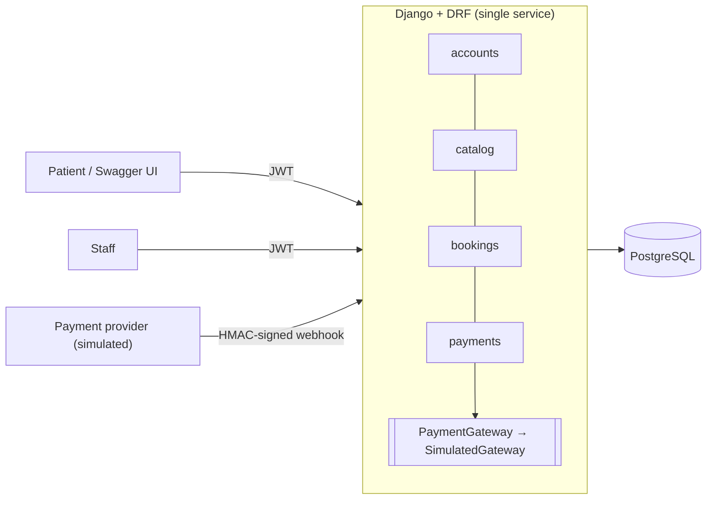
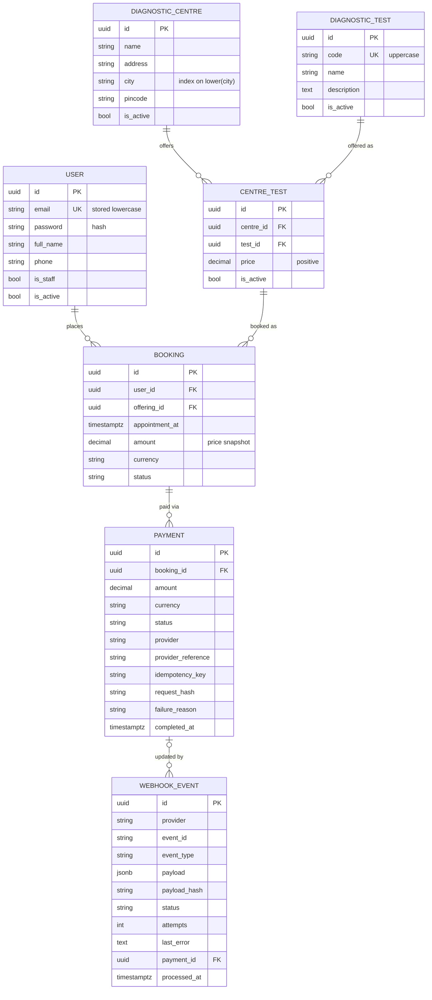

# EVE Diagnostics API

A backend for booking diagnostic tests at diagnostic centres and paying through a
simulated payment provider. It has an idempotent, signed payment webhook.

Built with **Django 5.2 LTS, Django REST Framework and PostgreSQL 17**.

The core problem here isn't CRUD. It's keeping booking and payment state correct when
a payment provider delivers notifications late, out of order, more than once or at the
same time. Most of the design follows from that.

- [Quick start](#quick-start)
- [API walkthrough](#api-walkthrough)
- [Endpoints](#endpoints)
- [Design](#design)
- [Database schema](#database-schema)
- [Edge cases](#edge-cases)
- [Testing](#testing)
- [Configuration](#configuration)
- [Assumptions](#assumptions)
- [What I'd improve with more time](#what-id-improve-with-more-time)

---

## Quick start

### With Docker (recommended)

Requirements: Docker with Compose v2.

```bash
docker compose up -d --build --wait api                          # api + postgres, runs migrations
docker compose exec api python manage.py seed_catalog            # demo centres, tests, prices
docker compose exec api python manage.py createsuperuser         # optional: an admin account
```

- API: <http://127.0.0.1:8000/api/v1/>
- Swagger UI: <http://127.0.0.1:8000/api/docs/>
- Django admin: <http://127.0.0.1:8000/admin/>
- Health: `/health/live/`, `/health/ready/`

Run the test suite in a container against the same Postgres:

```bash
docker compose --profile test run --rm tests
```

The compose file ships with development-only secrets so it works out of the box. Postgres
is published on `127.0.0.1:5433`, which avoids clashing with a locally installed Postgres.

### Without Docker for the app (local virtualenv)

Requirements: Python 3.13+ and a PostgreSQL database. The compose `db` service works fine
for this.

```bash
docker compose up -d --wait db
python -m venv .venv && source .venv/bin/activate      # Windows: .venv\Scripts\activate
pip install -r requirements-dev.txt
cp .env.example .env                                   # dev values; settings.py loads it
python manage.py migrate
python manage.py seed_catalog
python manage.py runserver
pytest
```

---

## API walkthrough

The examples use `curl` and `jq`. The Swagger UI does the same without a terminal.

```bash
API=http://127.0.0.1:8000/api/v1

# 1. Sign up and log in
curl -s -X POST $API/auth/signup/ -H 'Content-Type: application/json' \
  -d '{"email": "patient@example.com", "password": "a-long-passphrase-42", "full_name": "Test Patient"}'

TOKEN=$(curl -s -X POST $API/auth/login/ -H 'Content-Type: application/json' \
  -d '{"email": "patient@example.com", "password": "a-long-passphrase-42"}' | jq -r .access)
AUTH="Authorization: Bearer $TOKEN"

# 2. Find a centre in Pune and see its tests and prices (public)
CENTRE=$(curl -s "$API/centres/?city=pune" | jq -r '.results[0].id')
curl -s $API/centres/$CENTRE/ | jq
TEST=$(curl -s $API/centres/$CENTRE/ | jq -r '.tests[0].test.id')

# 3. Book: the amount is taken from the centre's price, and the booking starts PENDING
BOOKING=$(curl -s -X POST $API/bookings/ -H "$AUTH" -H 'Content-Type: application/json' \
  -d "{\"centre_id\": \"$CENTRE\", \"test_id\": \"$TEST\", \"appointment_at\": \"2026-10-05T09:30:00+05:30\"}" \
  | jq -r .id)

# 4a. Pay synchronously: SUCCESS confirms the booking, FAILED fails it
curl -s -X POST $API/payments/ -H "$AUTH" -H 'Content-Type: application/json' \
  -H 'Idempotency-Key: checkout-1' \
  -d "{\"booking_id\": \"$BOOKING\", \"simulate_outcome\": \"SUCCESS\"}" | jq
```

**4b. Pay asynchronously and let the webhook settle it.** Book again (a different time),
pay with `simulate_outcome: PENDING`, then act as the provider. The helper command signs
the event with the server's secret and delivers it twice, to show the duplicate handling:

```bash
BOOKING2=$(curl -s -X POST $API/bookings/ -H "$AUTH" -H 'Content-Type: application/json' \
  -d "{\"centre_id\": \"$CENTRE\", \"test_id\": \"$TEST\", \"appointment_at\": \"2026-10-06T09:30:00+05:30\"}" \
  | jq -r .id)
PAYMENT=$(curl -s -X POST $API/payments/ -H "$AUTH" -H 'Content-Type: application/json' \
  -d "{\"booking_id\": \"$BOOKING2\", \"simulate_outcome\": \"PENDING\"}")
REF=$(echo "$PAYMENT" | jq -r .provider_reference)
AMOUNT=$(echo "$PAYMENT" | jq -r .amount)

docker compose exec api python manage.py simulate_webhook $REF --outcome succeeded \
  --event-id evt_demo_1 --send http://127.0.0.1:8000/api/v1/payments/webhook/ --repeat 2
# delivery 1: HTTP 200 {"event_id":"evt_demo_1","result":"processed"}
# delivery 2: HTTP 200 {"event_id":"evt_demo_1","result":"duplicate"}

curl -s $API/bookings/$BOOKING2/ -H "$AUTH" | jq .status     # "CONFIRMED"
```

To sign a webhook by hand, compute an HMAC-SHA256 over `"{timestamp}.{raw body}"`. This
example sends a *conflicting* `payment.failed` event for the payment just confirmed; it
comes back `"ignored"` and the booking stays `CONFIRMED`:

```bash
SECRET=dev-only-webhook-secret-change-me
BODY='{"event_id":"evt_demo_2","event_type":"payment.failed","occurred_at":"2026-09-28T10:00:00Z","data":{"payment_reference":"'$REF'","booking_id":"'$BOOKING2'","amount":"'$AMOUNT'","currency":"INR"}}'
TS=$(date +%s)
SIG="sha256=$(printf '%s.%s' "$TS" "$BODY" | openssl dgst -sha256 -hmac "$SECRET" | sed 's/^.* //')"
curl -s -X POST $API/payments/webhook/ -H 'Content-Type: application/json' \
  -H "X-Webhook-Timestamp: $TS" -H "X-Webhook-Signature: $SIG" --data "$BODY"
# {"event_id":"evt_demo_2","result":"ignored"}
```

### Example responses

`POST /api/v1/bookings/` returns 201:

```json
{
  "id": "b7e2…",
  "user_id": "5d1c…",
  "status": "PENDING",
  "appointment_at": "2026-10-05T09:30:00+05:30",
  "amount": "349.00",
  "currency": "INR",
  "centre": {"id": "3f0c…", "name": "Sample Diagnostics Baner", "city": "Pune"},
  "test": {"id": "9a1b…", "code": "CBC", "name": "Complete Blood Count"},
  "payments": [],
  "created_at": "2026-09-28T16:02:11.120000+05:30",
  "updated_at": "2026-09-28T16:02:11.120000+05:30"
}
```

`POST /api/v1/payments/` returns 201, or 200 for an idempotent replay:

```json
{
  "id": "c41a…",
  "booking_id": "b7e2…",
  "status": "SUCCESS",
  "amount": "349.00",
  "currency": "INR",
  "provider": "simulated",
  "provider_reference": "sim_pay_8f3c…",
  "failure_reason": "",
  "booking_status": "CONFIRMED",
  "created_at": "…",
  "completed_at": "…"
}
```

Every error uses the same envelope:

```json
{
  "error": {
    "code": "BOOKING_NOT_PAYABLE",
    "message": "Booking is CONFIRMED and cannot accept a payment.",
    "details": {"status": "CONFIRMED"},
    "request_id": "0f5c2b7e9d3a4c1e8b6f2a7d9c0e1f23"
  }
}
```

---

## Endpoints

All API paths are under `/api/v1/`. The spec's `POST /payments/` and
`POST /payments/webhook/` are therefore `/api/v1/payments/` and
`/api/v1/payments/webhook/`.

| Method | Path | Auth | Purpose |
|---|---|---|---|
| POST | `/auth/signup/` | none | Create a patient account |
| POST | `/auth/login/` | none | Get an access + refresh token pair |
| POST | `/auth/token/refresh/` | refresh token | Rotate tokens (old refresh token is blacklisted) |
| POST | `/auth/logout/` | JWT | Blacklist your refresh token |
| GET | `/auth/me/` | JWT | Your profile |
| GET | `/centres/` | none | Active centres. Filters: `city`, `test` (test id), `search`, `ordering` |
| GET | `/centres/{id}/` | none | Centre with the tests it offers and their prices |
| POST, PATCH, DELETE | `/centres/`, `/centres/{id}/` | staff | Manage centres (DELETE deactivates) |
| GET | `/tests/`, `/tests/{id}/` | none | Test catalog. Filter: `search` (name or code) |
| POST, PATCH, DELETE | `/tests/`, `/tests/{id}/` | staff | Manage tests |
| GET | `/centres/{id}/tests/` | none | Offerings at a centre (test + price) |
| POST | `/centres/{id}/tests/` | staff | Offer a test at a price: `{test_id, price}` |
| GET, PATCH, DELETE | `/centres/{id}/tests/{test_id}/` | staff for writes | Change price or deactivate |
| POST | `/bookings/` | JWT | Book: `{centre_id, test_id, appointment_at}` |
| GET | `/bookings/` | JWT | Your bookings (staff: all). Filter: `status`; `ordering` |
| GET | `/bookings/{id}/` | JWT | Booking with its payment attempts |
| POST | `/bookings/{id}/cancel/` | JWT (owner) | Cancel a pending booking (safe to repeat) |
| POST | `/payments/` | JWT (booking owner) | Simulated payment: `{booking_id, simulate_outcome?}` + optional `Idempotency-Key` header |
| GET | `/payments/{id}/` | JWT (owner or staff) | Payment detail |
| POST | `/payments/webhook/` | HMAC signature | Provider status events |

**Conventions**
- UUID identifiers.
- Times are ISO 8601 with an offset. They're stored in UTC and rendered in IST.
- Money is a decimal string plus `currency`.
- Lists are paginated: `?page=&page_size=` (default 20, max 100), returning
  `{count, next, previous, results}`.

**Rate limits** (per IP for anonymous requests, per user once authenticated):

| Scope | Limit |
|---|---|
| Anonymous | 60/min |
| Authenticated user | 120/min |
| Login and token refresh | 10/min |
| Signup | 10/hour |
| Payment creation | 20/min |
| Webhook | 600/min |

---

## Design



A modular monolith with four apps: `accounts`, `catalog`, `bookings` and `payments`,
plus `common` for errors, logging, pagination and health. Each app is split into layers:

- **Views:** HTTP only (auth, permissions, status codes).
- **Serializers:** input shape and validation, output format.
- **Services:** business rules, transactions, row locks, state changes.
- **Models:** data and database constraints.

There's no repository layer, because the ORM already fills that role.

### State machines

```text
Booking:  PENDING ──payment SUCCESS──▶ CONFIRMED
             │    ──payment FAILED───▶ FAILED
             └──── patient cancels ──▶ CANCELLED        (all three are final)

Payment:  PENDING ──▶ SUCCESS | FAILED                   (both final)
```

Booking transitions live in `apps/bookings/state.py`, as pure functions with a
table-driven test. Status is never writable through the API. There's no PUT/PATCH on
bookings or payments.

### How a payment is processed

`POST /payments/` runs in three steps:

1. **Tx1:** lock the booking row (`SELECT … FOR UPDATE`), check it's payable, and insert
   a `PENDING` payment whose amount is copied from the booking.
2. **Gateway call, with no transaction open.** A real provider call must never hold row
   locks. If the process dies here, the `PENDING` row is an honest record that a charge
   was attempted.
3. **Tx2:** lock the booking, then the payment, and call `apply_payment_result()`.

`simulate_outcome` controls the simulated gateway:
- `SUCCESS` and `FAILED` settle the payment immediately.
- `PENDING` leaves the result to the webhook, which mirrors a real asynchronous provider.

### Why the webhook is idempotent

Both the synchronous path and the webhook end in the same function,
`apply_payment_result()`, and three layers make repeats harmless:

1. **Event inbox.** Each delivery is stored in `payment_webhook_event`, with one row per
   `(provider, event_id)`, enforced by a unique constraint. A redelivery finds the
   existing row.
   - The payload is hashed in canonical JSON form. The same `event_id` with different
     content is rejected with 409. Re-serialised JSON with the same content isn't.
2. **Row lock on the event.** Concurrent deliveries of one event queue up behind the lock.
   The first one processes it; the rest see `PROCESSED` and return `"duplicate"`. This is
   tested with six simultaneous deliveries.
3. **Final states are final.**
   - Applying an outcome the payment already has is a no-op.
   - A conflicting outcome, such as `FAILED` after `SUCCESS`, is never applied. The event
     is marked `IGNORED` and logged for reconciliation. `FAILED` then `SUCCESS` is logged
     at ERROR, because money may have been captured.

Webhook requests are authenticated by **HMAC-SHA256 over `"{timestamp}.{raw body}"`**:
- The check uses a constant-time comparison and a 5-minute window.
- Nothing is written to the database before the signature is verified.
- Without this check, anyone could mark their own booking as paid.

The webhook also cross-checks `amount`, `currency` and `booking_id` against the stored
payment.

**Retry handling.** Events that fail (unknown payment reference, mismatched data or an
unexpected error) are stored as `FAILED` with `attempts` and `last_error`, and the webhook
returns a non-2xx status. They're processed again when:
- the provider redelivers, or
- `python manage.py retry_webhook_events` runs (intended for cron; supports
  `--max-attempts`).

That command also picks up events left in `RECEIVED` by a crashed process.

Lock order is always booking, then payment. The event lock is only taken in the webhook
path, and it's taken first, so lock cycles can't happen.

### Other decisions

| Decision | Why |
|---|---|
| Booking references the **offering** (centre + test) | A booking for a test the centre doesn't offer can't be represented. The API still speaks in `centre_id` and `test_id`. |
| Amount **snapshotted** on the booking | Price changes don't rewrite history. The client never supplies an amount. |
| **404, not 403**, for other users' bookings and payments | Doesn't reveal that the resource exists. UUIDs aren't guessable anyway. |
| Soft deletes for catalog, **no deletes** for bookings, payments or events | Foreign keys are `PROTECT`. Payments and events are the audit trail. |
| Short-lived JWT (15 min) + rotating refresh (7 days) with blacklist | Stateless API with a working logout. No cookie auth, so no CSRF surface. |
| No Celery or Redis | Nothing is slow. Webhook retries are covered by redelivery plus a command. See improvements. |
| Structured JSON logs with request IDs | IDs only. Emails, tokens, signatures and test names (health data) are never logged, and sensitive fields are redacted. |

---

## Database schema



Every table also has `created_at` and `updated_at`. The invariants the code relies on are
enforced by PostgreSQL itself, so they hold even if application code has a bug or rows
are changed by hand:

| Constraint | Protects against |
|---|---|
| `UNIQUE(email)` + `CHECK(email = lower(email))` | Case-variant duplicate accounts |
| `UNIQUE(code)` + uppercase `CHECK` on tests | Duplicate test codes |
| `UNIQUE(centre_id, test_id)` on offerings | Two prices for one test at one centre |
| `CHECK(price > 0)`, `CHECK(amount > 0)` | Zero or negative charges |
| `CHECK(status IN …)` on bookings, payments, events | Invalid states (Django choices aren't enforced by the DB) |
| Partial `UNIQUE(user, offering, appointment_at) WHERE status IN (PENDING, CONFIRMED)` | Double-submitted bookings. Cancelled or failed bookings don't block rebooking. |
| Partial `UNIQUE(booking) WHERE status = SUCCESS` on payments | Paying twice for one booking |
| Partial `UNIQUE(booking) WHERE status = PENDING` on payments | Two payment attempts in flight at once |
| `UNIQUE(booking, idempotency_key)` | Duplicate attempts from client retries (NULL keys never collide) |
| `UNIQUE(provider, provider_reference)` | Two payments mapped to one provider charge |
| `CHECK((status = PENDING) = (completed_at IS NULL))` on payments | Settled payments without a completion time, and vice versa |
| `UNIQUE(provider, event_id)` on webhook events | Processing one event twice |

**Indexes:**
- `bookings(user_id, created_at DESC)` for the "my bookings" list
- `lower(city)` for the case-insensitive city filter
- `webhook_events(status, created_at)` for the retry scan
- Foreign key indexes, which Django creates automatically

---

## Edge cases

| Scenario | Result |
|---|---|
| Malformed JSON, missing or invalid fields | 400 `VALIDATION_ERROR` with field details |
| Booking ID that doesn't exist or belongs to someone else | 404 `BOOKING_NOT_FOUND` (same response for both) |
| Appointment in the past, more than 90 days ahead, or without a timezone offset | 400 |
| Test not offered at the centre, or centre, test or offering deactivated | 404 `OFFERING_NOT_FOUND` |
| Client sends `amount` or `status` | Ignored; the server sets both |
| Same booking submitted twice | 409 `DUPLICATE_BOOKING` |
| Paying a confirmed, failed or cancelled booking, or one whose time has passed | 409 `BOOKING_NOT_PAYABLE` |
| Second payment while one is pending, or cancelling while one is pending | 409 `PAYMENT_IN_PROGRESS` |
| Retry with the same `Idempotency-Key` | 200 with the original payment. A different body with the same key gives 422 `IDEMPOTENCY_KEY_REUSED`. |
| Simulated payment fails | Payment `FAILED`, booking `FAILED` (terminal; the patient rebooks) |
| Payment provider unreachable | 502 `GATEWAY_ERROR`; the payment stays `PENDING` for the webhook to settle |
| Webhook with missing or bad signature, tampered body, or stale timestamp | 401 `INVALID_SIGNATURE`; nothing is stored |
| Same webhook event delivered repeatedly or concurrently | Applied once; later deliveries get 200 `duplicate` |
| Same `event_id` with a different payload | 409 `EVENT_ID_CONFLICT` |
| Conflicting outcome for a settled payment | 200 `ignored`; the booking is untouched and the event is flagged |
| Webhook for an unknown payment, or with a mismatched amount, currency or booking | 404 or 422; stored as `FAILED` for retry |
| Unknown event type | 200 `ignored` (acknowledged so the provider stops resending) |
| Webhook body over 256 KB | 413 `PAYLOAD_TOO_LARGE` |
| PUT, PATCH or DELETE on bookings or payments | 405 |
| Non-staff user writing to the catalog | 403 (401 if anonymous) |
| `is_staff` sent on signup | Ignored |
| Too many login attempts | 429 `RATE_LIMITED` with `Retry-After` |

---

## Testing

```bash
pytest                          # 208 tests, ~20 s, against PostgreSQL
pytest --cov                    # ~95% line coverage
```

The suite runs against **PostgreSQL, not SQLite**. The guarantees above depend on
Postgres partial indexes and row locks, which SQLite doesn't provide.

| Area | Covered |
|---|---|
| Auth | Signup validation, case-insensitive duplicates, generic login errors, throttling, refresh rotation and blacklist, logout scoping |
| Catalog | Public vs staff access, filters, soft deletes, price validation, query-count budgets |
| Bookings | Server-side amount, time validation, ownership (404), duplicates, cancel rules, DB constraints, the full state-transition table |
| Payments | Each outcome, non-payable bookings, idempotency keys, gateway failure, the `apply_payment_result` decision table |
| Webhooks | Signature cases, payload validation, duplicates, re-serialised payloads, conflicts, mismatches, crash recovery, the retry command |
| Concurrency | Six threads delivering the same webhook, racing payment attempts, and racing retries with one idempotency key. These use real transactions. |
| End to end | Signup → login → browse → book → pay (pending) → webhook ×2 → confirmed |

CI (GitHub Actions) runs:
- ruff lint and format checks
- a check for missing migrations
- `check --deploy` with production settings
- OpenAPI schema validation
- the tests with a coverage gate
- `pip-audit`
- a Docker build and smoke test

---

## Configuration

All settings come from environment variables. `.env.example` lists them all with
development values. With `DJANGO_DEBUG=false`, the app refuses to start unless these
secrets are set:
- `DJANGO_SECRET_KEY`
- `JWT_SIGNING_KEY`
- `PAYMENT_WEBHOOK_SECRET`
- `POSTGRES_PASSWORD`

| Variable | Default | Notes |
|---|---|---|
| `DJANGO_DEBUG` | `false` | |
| `DJANGO_ALLOWED_HOSTS` | `localhost,127.0.0.1` | |
| `DJANGO_SECURE_SSL_REDIRECT`, `DJANGO_SECURE_HSTS_SECONDS`, `DJANGO_SECURE_COOKIES` | off / 0 / on when not DEBUG | Enable behind TLS |
| `POSTGRES_DB`, `POSTGRES_USER`, `POSTGRES_PASSWORD`, `POSTGRES_HOST`, `POSTGRES_PORT` | `eve`, `eve`, –, `127.0.0.1`, `5432` | |
| `JWT_ACCESS_TTL_MINUTES`, `JWT_REFRESH_TTL_DAYS` | `15`, `7` | |
| `PAYMENT_WEBHOOK_TOLERANCE_SECONDS` | `300` | Replay window |
| `PAYMENT_SIMULATION_DEFAULT_OUTCOME` | `SUCCESS` | When `simulate_outcome` is omitted |
| `BOOKING_MAX_ADVANCE_DAYS` | `90` | |
| `LOG_LEVEL`, `LOG_FORMAT` | `INFO`, `json` | `console` for human-readable logs |
| `API_DOCS_ENABLED` | `true` | Swagger UI and schema |

### Project layout

```text
config/            settings (env-driven), test settings, URLs
apps/common/       error envelope, exception handler, logging, middleware, health
apps/accounts/     email-based user, signup/login/logout
apps/catalog/      centres, tests, offerings (prices); seed_catalog command
apps/bookings/     booking model, state machine, services
apps/payments/     payments, gateway interface, webhook inbox; retry and simulate commands
tests/             pytest suite, mirroring the apps
docker/            container entrypoint
```

---

## Assumptions

- **The patient is the account holder.** There's no booking on behalf of family members.
- **Staff manage the catalog.** Reads are public. Admins are created only with
  `createsuperuser`; signup can never grant staff rights.
- **A failed booking is final.** After a failed payment the patient books again. The
  schema already allows several payment attempts per booking, so allowing retries is a
  small change.
- **Only pending bookings can be cancelled.** Cancelling a paid booking needs a refund
  flow, which is out of scope. Cancelling is also blocked while a payment is in flight.
- **No slot capacity or opening hours.** Any future time within 90 days can be booked. The
  same patient can't hold two active bookings for the same test, centre and time.
- **Single currency (INR).** Currency is still stored on bookings and payments.
- **Appointment times must include a timezone offset**, because a naive time is ambiguous.
- **The simulated gateway's outcome is chosen by the client** through `simulate_outcome`.
  Its references look like `sim_pay_…`.
- **Webhook event types:** `payment.succeeded` and `payment.failed` are acted on. Any other
  type is acknowledged and ignored.
- **Final payment states are final.** A conflicting later event is recorded for
  reconciliation, not applied.

---

## What I'd improve with more time

- **A real payment provider** (Razorpay, Cashfree or Stripe) behind the existing
  `PaymentGateway` interface. This would add order creation before charging, a
  reconciliation job that queries the provider for stuck `PENDING` payments, and refunds.
  Refunds would enable cancelling confirmed bookings.
- **Expire stale `PENDING` bookings** after a hold window, using a scheduled job.
- **Redis** for rate-limit counters. Today they use per-process memory, so with 3 gunicorn
  workers the effective limits are looser than configured. Redis could also cache the
  public catalog.
- **A background worker (Celery)** once there's slow work: confirmation emails or SMS, and
  processing webhooks asynchronously (store and acknowledge fast, process in a worker) at
  higher volume.
- **Slots and capacity** per centre, with opening hours.
- **Account features:** email verification, password reset, and optional MFA for staff.
- **Health-data compliance:** diagnostic bookings reveal health information, so India's
  DPDP Act applies. This would mean an access audit log, retention policies, and
  encryption at rest.
- **Observability:** Sentry, Prometheus/OpenTelemetry metrics, and alerts on `FAILED` or
  conflicting webhook events.
- **Finer admin roles** than `is_staff` (for example centre-level managers), and a
  booking status-history table.
